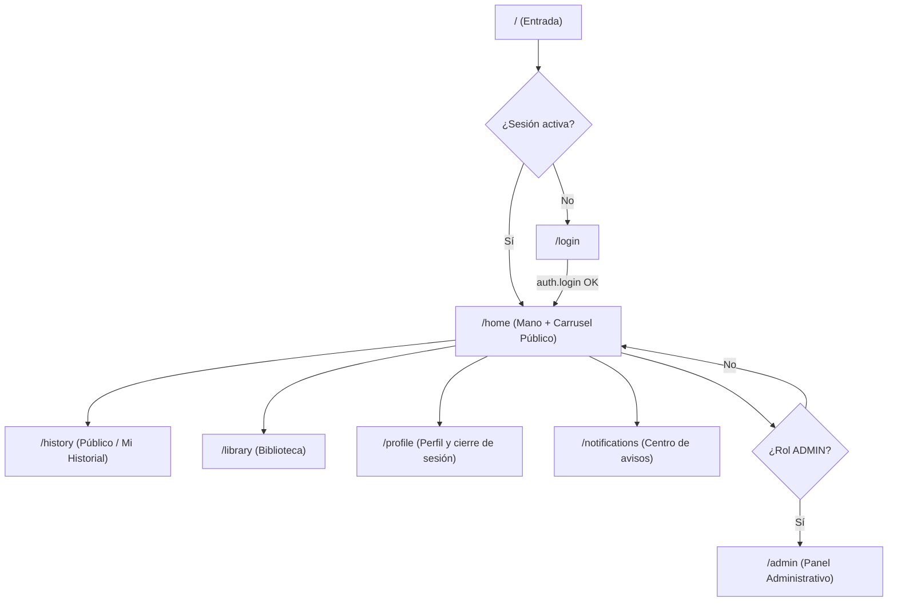
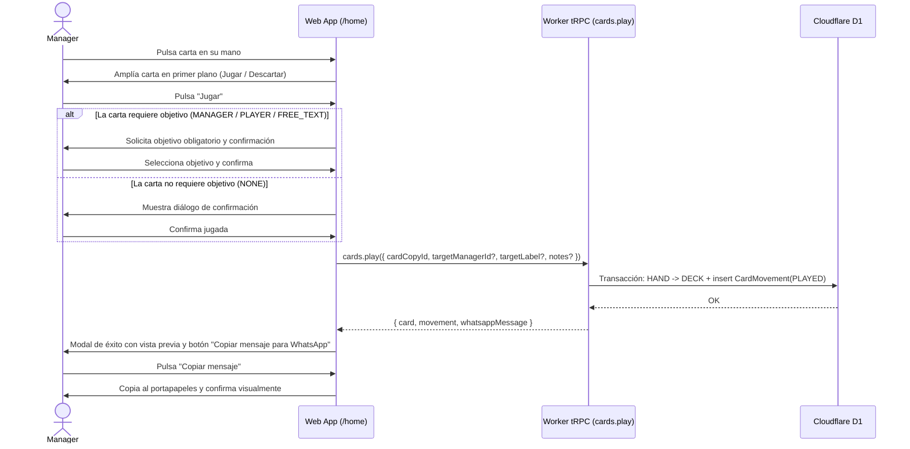

# Flujos de Usuario e Historias de Usuario

| Campo | Valor |
|--------|-------|
| Proyecto | Munchinking League |
| Documento | Flujos de Usuario e Historias de Usuario |
| Archivo | `01-user-flows-and-stories.md` |
| Versión | 1.0 |
| Estado | APPROVED |
| Última actualización | 17/11/2026 |

---

# 1. Objetivo

Este documento traduce la visión funcional de Munchinking League en **recorridos de usuario extremo a extremo**, **estados de pantalla** e **historias de usuario con criterios de aceptación verificables**.

Sirve como puente directo entre:

- `02-functional-specification.md` (qué debe hacer el producto).
- `06-api-contract.md` (qué procedimientos tRPC soporta el backend).
- `08-design-system.md` (cómo se representa e interactúa en interfaz).

---

# 2. Mapa de navegación y permisos

## Reglas globales de navegación

1. Si `auth.me` devuelve sesión válida en `/login`, redirigir automáticamente a `/home`.
2. Si cualquier consulta devuelve `UNAUTHORIZED`, limpiar caché de sesión y redirigir a `/login`.
3. Si un usuario con rol `MANAGER` navega manualmente a `/admin`, redirigir inmediatamente a `/home` sin exponer controles administrativos.
4. La barra inferior permanece fija en `/home`, `/history`, `/library`, `/profile` y `/admin`.

---

# 3. Flujos detallados de usuario

## 3.1 Flujo F-01 — Autenticación y persistencia de sesión

1. El usuario abre la aplicación desde el navegador móvil o PWA instalada.
2. Introduce `username` y `password` y pulsa **Iniciar sesión**.
3. El frontend ejecuta `auth.login`.
4. El Worker verifica credenciales, emite cookie de sesión segura (`HttpOnly`, `Secure`, `SameSite=Lax`) y devuelve `user` + `manager`.
5. El cliente redirige a `/home` y precarga `manager.getHand`, `notifications.unreadCount` e `history.public`.

**Casos borde:**
- Credenciales inválidas: mostrar mensaje claro sin revelar si falló usuario o contraseña.
- Cuenta deshabilitada (`isActive = false`): informar que debe contactar con el administrador.

---

## 3.2 Flujo F-02 — Consulta de mano y privacidad visual

1. Al entrar en `/home`, las cartas de la mano (0 a 3) aparecen en abanico **boca abajo** por defecto para evitar miradas indiscretas en persona.
2. El manager pulsa el botón **Mostrar cartas** (icono de ojo).
3. Las cartas giran con animación 3D suave mostrando anverso, rareza, nombre y apodo.
4. Mientras permanezca en `/home`, el estado visible/oculto se conserva.
5. Si no tiene cartas (`0/3`), se muestra un estado vacío ilustrado indicando cuándo será el próximo reparto semanal (lunes).

---

## 3.3 Flujo F-03 — Descubrimiento de nueva carta repartida

1. Cada lunes (o cuando el administrador ejecuta el reparto semanal), los managers con menos de 3 cartas reciben 1 `CardCopy` aleatoria desde `DECK`.
2. Se crea un `CardMovement` (`DISTRIBUTED`) y una `Notification` de tipo `CARD_DISTRIBUTED` con referencia al movimiento/carta.
3. En `/home` y `/notifications`, el contador superior muestra las notificaciones pendientes (`1..9` o `9+`).
4. Al abrir una notificación `CARD_DISTRIBUTED` no leída, se dispara el modal inmersivo de **Apertura / Descubrimiento de Carta** (reverso → destello según rareza → revelación del anverso) y se marca como leída (`notifications.markAsRead`).

---

## 3.4 Flujo F-04 — Jugar una carta y compartir en WhatsApp

**Reglas clave del flujo:**
- No existe estado intermedio de aprobación en la aplicación: la carta queda jugada al instante, aparece en el historial público y su copia regresa al `DECK`.
- Si la jugada incumplió una norma externa de la liga (por ejemplo, fuera de ventana de jornada), el administrador utiliza el flujo **F-06 Devolver carta**.

---

## 3.5 Flujo F-05 — Descartar una carta

1. El manager selecciona una carta de su mano en `/home`.
2. Pulsa **Descartar**.
3. Se muestra confirmación explícita advirtiendo que perderá la carta sin efecto de juego.
4. Al confirmar, `cards.discard` devuelve la `CardCopy` al `DECK` y registra `CardMovement` (`DISCARDED`).
5. La mano se actualiza; el movimiento aparece en **Mi historial** y en **Administración**, pero **nunca** en el historial público.

---

## 3.6 Flujo F-06 — Devolución administrativa de una carta mal jugada

1. Un manager juega por error o fuera de plazo una carta y lo comunican en WhatsApp.
2. El administrador entra en `/admin`, localiza el movimiento `PLAYED` reciente y pulsa **Devolver carta**.
3. El modal administrativo solicita motivo opcional y confirma la operación.
4. El backend ejecuta `admin.returnCard({ movementId, reason? })`:
   - Verifica que el movimiento original es `PLAYED` y no ha sido devuelto previamente.
   - Verifica que el manager destinatario tiene actualmente **menos de 3 cartas** en `HAND`.
   - Si la `CardCopy` original sigue libre en `DECK`, reutiliza esa misma copia; si ya hubiera sido repartida de nuevo, toma otra copia disponible en `DECK` de la misma `CardDefinition` (o devuelve `CONFLICT` explicando la causa).
   - Pasa la copia a `HAND` del manager, crea `CardMovement` (`RETURNED`) vinculado al movimiento original y genera una `Notification` (`CARD_RETURNED`) al manager afectado.
   - Marca el movimiento `PLAYED` original con referencia de reversión para que el historial público muestre claramente que la jugada fue **anulada/devuelta** o la excluya del carrusel activo según filtro, sin borrar jamás ningún registro histórico.

---

## 3.7 Flujo F-07 — Ejecución del reparto semanal (automático y manual)

1. **Automático (Cron Trigger Cloudflare Workers):** todos los lunes a las `08:00 Europe/Madrid`, el Worker calcula la clave ISO de semana (`YYYY-Www`) para la `Season` activa e invoca el caso de uso `ExecuteDistribution`.
2. **Manual desde `/admin`:** si el administrador desea lanzar o reintentar el reparto de la semana en curso, pulsa **Ejecutar reparto semanal**.
3. **Idempotencia:** si ya existe un `DistributionBatch` completado para `(seasonId, weekKey)`, el sistema rechaza duplicar el reparto con código `CONFLICT` (`ALREADY_DISTRIBUTED_THIS_WEEK`).
4. Solo reciben carta los managers activos de la liga que tengan `0`, `1` o `2` cartas en `HAND`. Los managers con `3` cartas quedan registrados en el resumen del lote como omitidos por mano completa.

---

# 4. Catálogo de Historias de Usuario y Criterios de Aceptación

## Épica 1 — Acceso y Sesión

### HU-01 — Inicio de sesión de manager
**Como** manager de la liga, **quiero** iniciar sesión con mi usuario y contraseña **para** acceder de forma privada a mi mano y mis notificaciones.

**Criterios de aceptación:**
- Dado un usuario activo con credenciales válidas, cuando envía el formulario de `/login`, entonces accede a `/home` y su sesión persiste al recargar el navegador.
- Dado un usuario con credenciales inválidas, cuando intenta iniciar sesión, entonces recibe un error genérico y permanece en `/login`.
- Dado un usuario ya autenticado, cuando visita `/login`, entonces es redirigido automáticamente a `/home`.

### HU-02 — Cierre de sesión
**Como** manager, **quiero** cerrar mi sesión desde `/profile` **para** proteger mi cuenta si uso un dispositivo compartido.

**Criterios de aceptación:**
- Al pulsar **Cerrar sesión**, la cookie queda invalidada en servidor, se limpia la caché local de TanStack Query y se redirige a `/login`.

---

## Épica 2 — Mano de Cartas y Juego

### HU-03 — Visualización protegida de la mano en abanico
**Como** manager, **quiero** que mis cartas aparezcan inicialmente boca abajo y poder alternar su visibilidad **para** consultar mi mano sin que otros managers la vean accidentalmente.

**Criterios de aceptación:**
- Al cargar `/home`, todas las cartas en mano aparecen boca abajo.
- El botón de visibilidad muestra u oculta todas las cartas simultáneamente con transición fluida.
- Nunca se renderizan más de 3 cartas en la mano.

### HU-04 — Selección y juego de carta con mensaje de WhatsApp
**Como** manager, **quiero** jugar una carta de mi mano y obtener el texto oficial listo para copiar **para** anunciarla en el grupo de WhatsApp sin errores de formato.

**Criterios de aceptación:**
- Solo puedo jugar cartas que estén actualmente en mi mano dentro de la temporada activa.
- Si la carta exige objetivo (`MANAGER`, `PLAYER` o `FREE_TEXT`), el botón de confirmar permanece deshabilitado hasta completarlo.
- Al confirmar, la carta sale de mi mano, regresa al `DECK`, aparece en el historial público y se muestra el mensaje renderizado con botón **Copiar mensaje**.
- Pulsar **Copiar mensaje** copia el texto exacto al portapapeles y muestra confirmación visual.

### HU-05 — Descarte voluntario de carta
**Como** manager, **quiero** descartar una carta de mi mano **para** liberar hueco antes del reparto del lunes si no me interesa conservarla.

**Criterios de aceptación:**
- El sistema solicita confirmación antes de ejecutar el descarte.
- Tras confirmar, la carta pasa a `DECK`, desaparece de mi mano y se registra en mi historial personal como `DISCARDED`.
- El descarte no aparece nunca en el carrusel ni en la vista pública de `/history`.

---

## Épica 3 — Biblioteca, Historial y Notificaciones

### HU-06 — Consulta de Biblioteca con filtros
**Como** manager, **quiero** explorar todas las cartas de la liga buscando por nombre o filtrando por rareza **para** conocer sus reglas exactas y cuántas copias existen en la temporada.

**Criterios de aceptación:**
- `/library` lista todas las `CardDefinition` activas mostrando imagen, nombre, apodo, rareza, descripción, reglas de uso, tipo de objetivo y copias configuradas en la temporada activa.
- Permite búsqueda por texto (nombre/apodo) y filtro por rareza sin recargar la página.
- No muestra botones de jugar ni descartar.

### HU-07 — Historial público y personal diferenciado
**Como** manager, **quiero** alternar en `/history` entre el historial público de la liga y mi historial personal **para** revisar tanto las cartas jugadas por todos como todos mis movimientos propios.

**Criterios de aceptación:**
- La pestaña **Público** muestra únicamente movimientos `PLAYED` en orden cronológico inverso con paginación por cursor, indicando si alguna jugada fue posteriormente devuelta por el administrador.
- La pestaña **Mis movimientos** muestra exclusivamente mis movimientos (`DISTRIBUTED`, `PLAYED`, `DISCARDED`, `RETURNED`) con filtro por tipo.

### HU-08 — Centro de notificaciones y revelación de carta
**Como** manager, **quiero** ver cuántas notificaciones pendientes tengo y descubrir con animación mis nuevas cartas **para** enterarme inmediatamente de repartos, devoluciones o avisos.

**Criterios de aceptación:**
- La cabecera muestra badge numérico `1..9` o `9+` cuando existen notificaciones no leídas, y ningún badge cuando el contador es `0`.
- Abrir una notificación no leída invoca `notifications.markAsRead` y decrementa el contador.
- Si la notificación es de reparto semanal no revelada aún, reproduce la animación de descubrimiento de la carta recibida.

---

## Épica 4 — Administración y Operación de Temporada

### HU-09 — Auditoría completa de movimientos
**Como** administrador, **quiero** consultar todos los movimientos de todos los managers filtrando por manager y tipo de movimiento **para** supervisar la temporada y resolver dudas.

**Criterios de aceptación:**
- `/admin` permite filtrar por `managerId` y `movementType` (`DISTRIBUTED`, `PLAYED`, `DISCARDED`, `RETURNED`) con paginación por cursor.
- Usuarios con rol `MANAGER` reciben `FORBIDDEN` si invocan cualquier procedimiento `admin.*` o `distribution.*`.

### HU-10 — Devolución de carta jugada indebidamente
**Como** administrador, **quiero** devolver una carta jugada por error a la mano de su manager **para** corregir incidencias sin borrar la trazabilidad histórica.

**Criterios de aceptación:**
- Desde un movimiento `PLAYED` no revertido, el administrador puede ejecutar la devolución indicando motivo opcional.
- Si el manager ya tiene 3 cartas en mano, el sistema bloquea la devolución con mensaje claro (`HAND_LIMIT_REACHED`).
- Al completarse, se crea un nuevo movimiento `RETURNED`, el manager recibe una notificación `CARD_RETURNED` y ningún movimiento previo es eliminado.

### HU-11 — Reparto semanal idempotente y avisos globales
**Como** administrador, **quiero** verificar el estado del reparto semanal, lanzarlo manualmente si fuera necesario y enviar avisos a managers **para** operar la liga sin depender de tareas manuales fuera de la app.

**Criterios de aceptación:**
- El panel `/admin` muestra si el reparto de la semana ISO actual ya se ejecutó, cuántos managers recibieron carta y quiénes tenían mano llena.
- Ejecutar manualmente el reparto en una semana ya repartida no duplica cartas y devuelve aviso controlado.
- El administrador puede enviar un aviso informativo a un manager concreto o a toda la liga generando notificaciones `ADMIN_NOTICE`.

---

# 5. Matriz de trazabilidad rápida

| Historia | Pantalla | Procedimientos tRPC principales |
|----------|----------|---------------------------------|
| HU-01, HU-02 | `/login`, `/profile` | `auth.login`, `auth.logout`, `auth.me`, `manager.getProfile` |
| HU-03, HU-04, HU-05 | `/home` | `manager.getHand`, `manager.listTargets`, `cards.play`, `cards.discard` |
| HU-06 | `/library` | `library.list` |
| HU-07 | `/home`, `/history` | `history.public`, `history.mine` |
| HU-08 | `/notifications`, cabecera | `notifications.list`, `notifications.unreadCount`, `notifications.markAsRead`, `notifications.markAllAsRead` |
| HU-09, HU-10, HU-11 | `/admin` | `admin.history`, `admin.returnCard`, `admin.sendNotice`, `distribution.status`, `distribution.execute` |

---

# 6. Historial de cambios

| Versión | Descripción |
|----------|-------------|
| 1.0 | Creación completa de flujos de usuario extremo a extremo, diagramas e historias de usuario con criterios de aceptación verificables. |
