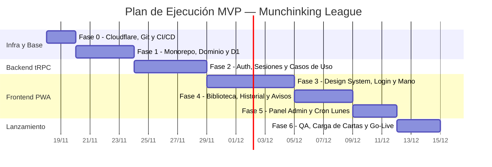

# Hoja de Ruta, Infraestructura y Plan de Ejecución

| Campo                | Valor                                             |
| -------------------- | ------------------------------------------------- |
| Proyecto             | Munchinking League                                |
| Documento            | Hoja de Ruta, Infraestructura y Plan de Ejecución |
| Archivo              | `10-roadmap-and-execution-plan.md`                |
| Versión              | 1.0                                               |
| Estado               | APPROVED                                          |
| Última actualización | 17/11/2026                                        |

---

# 1. Objetivo

Definir el **plan operativo paso a paso** para:

1. Configurar toda la infraestructura gratuita en **Cloudflare** y **GitHub**.
2. Inicializar el monorepo TypeScript cumpliendo estrictamente `03-architecture.md` y `07-project-structure.md`.
3. Ejecutar el desarrollo del **MVP (v1.0)** por fases ordenadas, con entregables verificables y puertas de calidad (_Definition of Done_).
4. Planificar la evolución hacia **v1.1** y **v2.0**.

---

# 2. Arquitectura de Entornos y Límites del Plan Gratuito

Toda la solución opera a **coste 0 €** dentro del Free Tier de Cloudflare para una liga de 8–10 managers:

| Servicio Cloudflare    | Uso en Munchinking League                    | Cuota gratuita aproximada                       | Consumo estimado liga (10 managers)         |
| ---------------------- | -------------------------------------------- | ----------------------------------------------- | ------------------------------------------- |
| **Cloudflare Pages**   | Hosting SPA React + PWA + previews por rama  | Builds y ancho de banda generosos               | < 1% de la cuota                            |
| **Cloudflare Workers** | API tRPC + autenticación + Cron semanal      | 100.000 req/día                                 | < 500 req/día                               |
| **Cloudflare D1**      | Base de datos relacional SQLite              | 5M lecturas/día · 100k escrituras/día · 5 GB    | < 5.000 lecturas/día · < 100 escrituras/día |
| **Cloudflare R2**      | Imágenes `.webp` de cartas, avatares y logos | 10 GB almacenamiento · 10M lecturas Clase B/mes | < 50 MB totales                             |

## Estrategia de entornos y ramas Git

| Entorno               | Rama Git    | Frontend (Pages)                           | Backend (Workers)                 | Base de datos D1              | Bucket R2                             |
| --------------------- | ----------- | ------------------------------------------ | --------------------------------- | ----------------------------- | ------------------------------------- |
| **Local**             | `feature/*` | `localhost:5173` (Vite)                    | `localhost:8787` (`wrangler dev`) | D1 SQLite local (`.wrangler`) | Emulación R2 local / carpeta `public` |
| **Staging / Preview** | `develop`   | Preview URL `develop.<proyecto>.pages.dev` | `munchinking-api-staging`         | `munchinking-db-staging`      | `munchinking-assets-staging`          |
| **Producción**        | `main`      | `<proyecto>.pages.dev` (o dominio custom)  | `munchinking-api`                 | `munchinking-db`              | `munchinking-assets`                  |

> **Recomendación clave de enrutamiento y cookies:** exponer el Worker o vincularlo bajo el mismo origen de Pages (`/trpc/*` mediante proxy/Service Binding en Pages Functions, o subdominios hermanos bajo un mismo dominio) para que las cookies `HttpOnly; Secure; SameSite=Lax` funcionen en iOS Safari sin bloqueos de cookies de terceros (ITP).

---

# 3. Plan de Configuración de Infraestructura (Fase 0)

## Paso 0.1 — Higiene de Git y ramas en GitHub

1. Consolidar `develop` como rama base activa de desarrollo y sincronizar `main` mediante Pull Request para eliminar el desfase inicial (actualmente `main` no tenía los documentos de `develop`).
2. Activar **Branch Protection** en `main` y `develop`: exigir que pasen `typecheck`, `lint` y `test` en GitHub Actions antes de fusionar.
3. Configurar autenticación Git en la máquina local con **Git Credential Manager** o `gh auth login` (nunca incrustar un PAT en la URL remota de `.git/config`).

## Paso 0.2 — Aprovisionamiento en Cloudflare (vía Wrangler CLI)

Prerrequisitos locales: **Node.js 22 LTS**, **pnpm 9+** y `npx wrangler login`.

1. **Crear bases de datos D1:**
   - Staging: `wrangler d1 create munchinking-db-staging`
   - Producción: `wrangler d1 create munchinking-db`
   - Copiar los `database_id` generados (no son secretos, van en `wrangler.toml` por entorno).
2. **Crear buckets R2 para ilustraciones de cartas:**
   - Staging: `wrangler r2 bucket create munchinking-assets-staging`
   - Producción: `wrangler r2 bucket create munchinking-assets`
   - Habilitar acceso público de solo lectura (CDN `r2.dev` en staging o subdominio caché en producción) y política de caché larga (`Cache-Control: public, max-age=31536000, immutable`).
3. **Configurar secretos en Workers (nunca en Git):**
   - `wrangler secret put SESSION_SECRET --env staging`
   - `wrangler secret put SESSION_SECRET --env production`
4. **Configurar Cron Trigger semanal en `wrangler.toml`:**
   - `[triggers] crons = ["0 7 * * MON"]` (ejecución los lunes por la mañana UTC; el handler verifica hora/semana ISO en `Europe/Madrid` y se apoya en `distribution_batch` para idempotencia exacta).
5. **Crear proyecto Cloudflare Pages:**
   - Conectar con el repositorio `Pablo0139/munchinking-league`.
   - Rama de producción: `main` · Rama preview: `develop`.
   - Comando de build: `pnpm --filter @munchinking/web build` · Directorio de salida: `apps/web/dist`.

## Paso 0.3 — Pipeline CI/CD en GitHub Actions

Crear dos flujos en `.github/workflows/`:

- `ci.yml` (en cada PR / push): `pnpm install --frozen-lockfile` → `pnpm lint` → `pnpm typecheck` → `pnpm test`.
- `deploy.yml` (en push a `develop` o `main`): aplica migraciones D1 (`wrangler d1 migrations apply --remote`), despliega `apps/api` con Wrangler usando `CLOUDFLARE_API_TOKEN` + `CLOUDFLARE_ACCOUNT_ID` guardados en **GitHub Repository Secrets**, y publica frontend en Pages.

---

# 4. Plan de Desarrollo del MVP por Fases (Fases 1 a 6)

---

## Fase 1 — Scaffolding del Monorepo, Dominio Puro y Esquema D1

**Objetivo:** dejar el repositorio compilando de extremo a extremo en local con base de datos y tests unitarios de dominio funcionando.

**Tareas:**

1. Crear `pnpm-workspace.yaml`, `package.json` raíz, `tsconfig.base.json`, ESLint, Prettier, Vitest y `.gitignore` / `.env.example`.
2. Implementar `packages/shared` (enums `CardRarity`, `CardLocation`, `MovementType`, `TargetType`, `UserRole`, esquemas Zod comunes).
3. Implementar `packages/domain` sin dependencias externas:
   - Entidades e invariantes (`MAX_HAND_SIZE = 3`, transiciones válidas `DECK <-> HAND`, no auto-reversión duplicada).
   - Servicio puro `WhatsappTemplateRenderer` con batería de tests unitarios.
4. Implementar `db/schema/` con Drizzle ORM + primera migración SQL en `db/migrations/` incluyendo los índices únicos parciales y `CHECK` definidos en `05-data-model.md`.
5. Implementar `db/seed/dev.seed.ts` cargando la liga, temporada activa, 9 cuentas de prueba y las 40 `CardCopy` iniciales.

**Criterio de cierre (DoD):** `pnpm test` pasa al 100% sobre `packages/domain` y `wrangler d1 migrations apply --local` + `pnpm db:seed:local` levantan la base SQLite local sin errores.

---

## Fase 2 — Backend Cloudflare Worker + API tRPC Completa

**Objetivo:** tener todos los routers de `06-api-contract.md` operativos y probados contra D1 local.

**Tareas:**

1. Configurar `apps/api` con Cloudflare Workers + adaptador fetch de tRPC + contexto tipado (`db`, `session`, `user`, `manager`, `activeSeason`).
2. Implementar hashing `PBKDF2-SHA256` con Web Crypto API, tabla `session` y cookies seguras en `auth.login`, `auth.logout` y `auth.me`.
3. Implementar repositorios Drizzle en `apps/api/src/infrastructure/repositories/`.
4. Implementar casos de uso transaccionales (`db.batch` + condiciones optimistas):
   - `GetManagerProfile`, `GetManagerHand`, `ListTargetManagers`.
   - `PlayCard` (con generación del mensaje oficial de WhatsApp) y `DiscardCard`.
   - `GetPublicHistory`, `GetPersonalHistory`, `ListLibraryCards`.
   - `ListNotifications`, `GetUnreadCount`, `MarkNotificationAsRead`, `MarkAllNotificationsAsRead`.
   - `ExecuteDistribution` + `GetDistributionStatus` + handler `scheduled()` para el Cron de los lunes.
   - `GetAdminHistory`, `ReturnCard` (por `movementId`) y `SendAdminNotice`.
5. Añadir tests de integración de API (Vitest + Miniflare / `@cloudflare/vitest-pool-workers`) cubriendo permisos `MANAGER` vs `ADMIN`, límite de 3 cartas, concurrencia al jugar y bloqueo de doble reparto semanal.

**Criterio de cierre (DoD):** todos los procedimientos tRPC responden tipados y superan tests de casos felices y de error (`UNAUTHORIZED`, `FORBIDDEN`, `CONFLICT`, `BAD_REQUEST`).

---

## Fase 3 — Frontend Base, Design System y Pantalla Principal (`/login` y `/home`)

**Objetivo:** entregar el núcleo de experiencia táctil y visual del manager.

**Tareas:**

1. Inicializar `apps/web` con React + Vite + TypeScript + Tailwind CSS + TanStack Router + TanStack Query + cliente tRPC tipado contra `AppRouter`.
2. Configurar tokens visuales de `08-design-system.md`, layout Mobile First, cabecera superior, `BottomNavigation` y `manifest.webmanifest` (PWA).
3. Implementar `/login` y guardas de ruta autenticadas.
4. Construir los componentes estrella:
   - `Card` y `CardBack` (proporción 5:7, marco e icono geométrico + color por rareza).
   - `CardFan` (abanico adaptable a 0, 1, 2 o 3 cartas, boca abajo al entrar y toggle de ojo para mostrar/ocultar).
   - Modal `CardFocusSheet` con selector dinámico de objetivo (`MANAGER`, `PLAYER`, `FREE_TEXT`), confirmación de **Jugar** o **Descartar**, y modal final con vista previa y botón **Copiar mensaje para WhatsApp**.
5. Añadir el carrusel horizontal inferior de **Últimas cartas jugadas** en `/home`.

**Criterio de cierre (DoD):** un manager puede iniciar sesión en móvil, revelar su mano, jugar una carta con objetivo, copiar el mensaje de WhatsApp en un toque y ver actualizado el carrusel público al instante.

---

## Fase 4 — Biblioteca, Historial, Notificaciones y Perfil

**Objetivo:** completar todas las pantallas del rol `MANAGER`.

**Tareas:**

1. `/library`: cuadrícula de catálogo con buscador instantáneo, chips de filtro por rareza y modal de detalle con reglas completas y copias por temporada.
2. `/history`: pestañas **Público** y **Mis movimientos**, filtros por tipo de movimiento y scroll/paginación por cursor.
3. `/notifications`: lista cronológica, marcado automático de lectura, botón **Marcar todas como leídas** y modal animado de **Descubrimiento de nueva carta** al abrir notificaciones `CARD_DISTRIBUTED`.
4. `/profile`: avatar, nombre de equipo, métricas de temporada (jugadas, descartadas, devueltas, en mano) y cierre de sesión.

**Criterio de cierre (DoD):** navegación completa sin enlaces rotos, badge `9+` sincronizado en tiempo real tras leer avisos y animación de revelación funcionando con `prefers-reduced-motion` contemplado.

---

## Fase 5 — Panel de Administración (`/admin`) y Automatización Semanal

**Objetivo:** dotar al administrador de control total y auditable de la temporada.

**Tareas:**

1. Guardia de ruta exclusiva `ADMIN` y acceso en la barra inferior solo visible para administradores.
2. Vista de auditoría completa con filtros por manager y tipo (`DISTRIBUTED`, `PLAYED`, `DISCARDED`, `RETURNED`).
3. Flujo de **Devolver carta** sobre jugadas `PLAYED` con motivo opcional y validación visual si el manager tiene la mano llena (`3/3`).
4. Tarjeta operativa de **Reparto semanal**: indicador de estado de la semana ISO actual, disparo manual seguro y formulario rápido para enviar avisos (`ADMIN_NOTICE`) a un manager o a toda la liga.

**Criterio de cierre (DoD):** el administrador puede corregir una jugada errónea, comprobar que el manager recibe la carta y la notificación, y verificar el Cron semanal en entorno `staging`.

---

## Fase 6 — Carga del Catálogo Definitivo, QA en Dispositivos y Puesta en Producción

**Objetivo:** salir en vivo con los managers reales de la Munchinking League.

**Tareas:**

1. Validar y cargar en `cards.production.json` los textos definitivos e ilustraciones optimizadas `.webp` (`<= 120 KB` por carta) en el bucket R2 de producción.
2. Ejecutar migraciones en `munchinking-db` (producción) y lanzar el script de aprovisionamiento de la liga, temporada activa y cuentas reales de los managers.
3. Prueba piloto rápida en `staging` desde iOS Safari y Android Chrome (instalación en pantalla de inicio, copiado al portapapeles de WhatsApp, cookies de sesión).
4. Promoción `develop` → `main`, verificación del despliegue en Cloudflare Pages/Workers y entrega de credenciales iniciales a los managers.

---

# 5. Evolución posterior al MVP

- **Versión 1.1 (Pulido de experiencia):** efectos de sonido opcionales silenciables, estadísticas de temporada por manager/carta (carta más jugada, manager más castigado) y selector de temporadas históricas en modo lectura.
- **Versión 2.0 (Conector desacoplado con Biwenger):** módulo aislado en `apps/api/src/infrastructure/services/biwenger/` para sincronizar managers/plantillas/jornadas de lectura y asistir al administrador sin acoplar el dominio.

---

# 6. Historial de cambios

| Versión | Descripción                                                                                                                                                         |
| ------- | ------------------------------------------------------------------------------------------------------------------------------------------------------------------- |
| 1.0     | Creación de la hoja de ruta oficial, dimensionamiento de Cloudflare Free Tier, checklist de infraestructura y plan de desarrollo por fases con criterios de cierre. |
